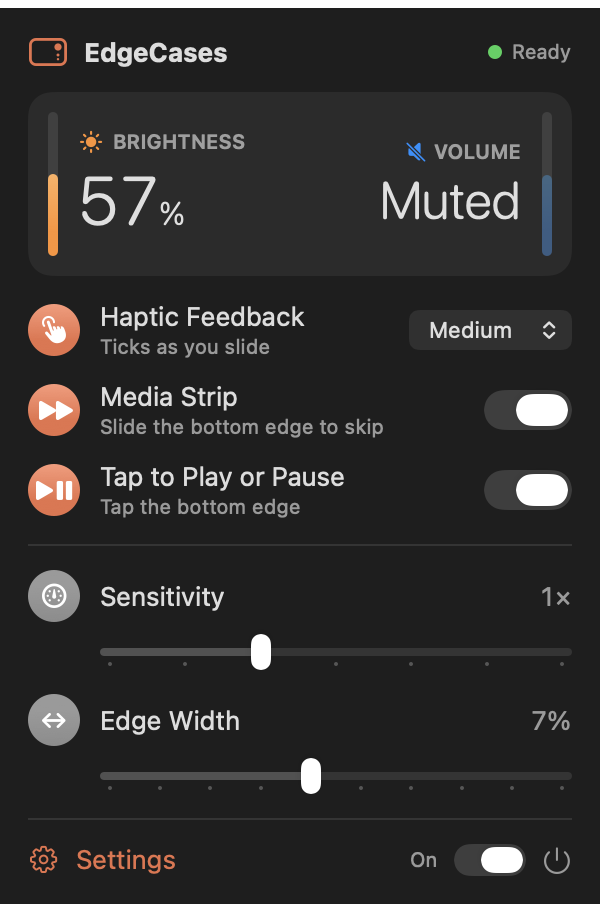
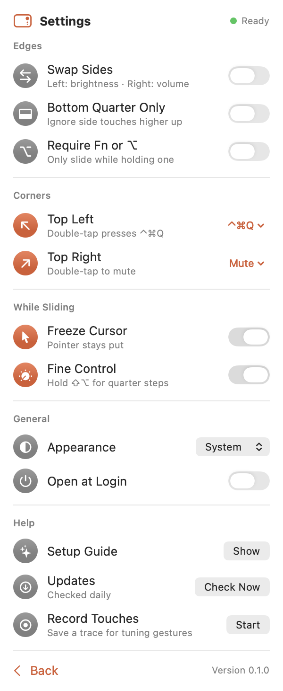

# EdgeCases

Slide along the edges of your MacBook trackpad to change brightness (left edge) and volume
(right edge). Lives in the menu bar. A personal project, inspired by [EdgeBar](https://edgebar.xyz/).

<p>
  
  
</p>

## What it does

- **Left edge:** slide up or down for brightness. **Right edge:** volume. Swap them if you like.
- **Bottom edge:** swipe to skip tracks; optionally tap to play or pause.
- **Top corners:** double-tap to mute, play or pause, press any keyboard shortcut you record
  (⌘Space for Raycast, ⌃⌘Q to lock), or open an app.
- Uses the system's own brightness and volume keys, so you get the usual on-screen display.
- Haptic ticks as you slide (off, light, medium, or strong), a frozen pointer while sliding, and
  quarter steps while holding ⇧⌥.
- Ignores touches while you type, resting palms, real clicks, and ordinary pointing.

## Install

Download the DMG from the [latest release](https://github.com/sameerkishore/edgecases/releases/latest)
and drag EdgeCases onto Applications. It isn't notarized, so the first time you open it, click Done
on the warning, then go to System Settings → Privacy & Security and click **Open Anyway**. EdgeCases
then asks for Accessibility access, which it needs to press the brightness and volume keys for you.
After that it updates itself.

Needs an Apple silicon MacBook with macOS 14 or later. It reads the built-in trackpad through
Apple's private MultitouchSupport framework, so a macOS update could break it.

## Build

```bash
./scripts/run.sh        # debug build, launches from build/
./scripts/install.sh    # release build into /Applications (use this for Open at Login)
./scripts/make_dmg.sh   # release build packaged as build/EdgeCases.dmg
./scripts/bump_version.sh 0.2.0                # set the version and bump the build number Sparkle compares
./scripts/publish_release.sh 0.2.0 "notes"     # for a pushed tag: DMG + appcast.xml on a GitHub release
```

Requires Xcode, XcodeGen (`brew install xcodegen`), and a code signing identity named
"EdgeCases Signing" in the login Keychain (a self-signed certificate is enough; a stable signature
keeps the Accessibility grant across rebuilds and updates). The Xcode project is generated from
`project.yml`; run `xcodegen generate` to open it in Xcode. Gesture engine tests:
`cd Packages/EdgeCore && swift test`.

Releases are signed for Sparkle with an EdDSA key kept in the login Keychain under the `edgecases`
account (`generate_keys --account edgecases`). Back it up along with the signing certificate: without
them, existing installs can't update.

If the Accessibility toggle is on but nothing happens, remove the entry with − and add it again:
macOS ties the grant to the app's signature.

## Layout

| Path | What |
|---|---|
| `Packages/EdgeCore` | The edge gesture engine: trackpad frames in, slides, taps, and steps out (`swift test`) |
| `EdgeCases/Touch` | Bridge to the private MultitouchSupport framework (touches, haptics), the monitor that feeds the engine, and the key/click/pointer tap |
| `EdgeCases/System` | Media keys, key combos, haptics, live levels, cursor lock, login item, Accessibility |
| `EdgeCases/App` | App entry, preferences, corner actions, and the controller that maps gestures to actions |
| `EdgeCases/UI` | SwiftUI menu bar panel, Settings page, and setup guide |
| `scripts/make-icons.swift` | Draws the app icon, menu bar glyphs, and coral accent into `Assets.xcassets` |

Settings → Record Touches saves real trackpad traces (with key presses and clicks) as JSON, for
turning tricky cases into `Trace.replay` tests.

Debug and release builds accept `-snapshot <folder>`, which renders the panel, Settings, and setup
guide in light and dark to PNGs and quits. Launch it through `open` so it renders with the app's own
Accessibility state:
`open -n build/Build/Products/Debug/EdgeCases.app --args -snapshot /tmp/snaps`

Logs: `/usr/bin/log stream --level info --predicate 'subsystem == "app.edgecases.EdgeCases"'`

## Workflow

Each feature or fix gets its own branch off `main` (short kebab-case name, like `corner-actions`)
and a pull request titled with what changes for the user ("Corners can open any app"). PRs are
squash-merged, so `main` reads as one commit per feature.

Releases bundle 3–5 merged features:

1. Branch `release-0.2.0`, run `./scripts/bump_version.sh 0.2.0`, and open a "Version 0.2.0" PR.
2. Squash-merge it, then on the updated `main`: `git tag 0.2.0 && git push origin 0.2.0`.
3. `./scripts/publish_release.sh 0.2.0 "notes"` builds, signs, and publishes the DMG and appcast.
4. Delete the release's feature branches, locally and on GitHub.

## Contributing

Issues and pull requests are welcome. For gesture changes, a recorded trace that shows the problem
(Settings → Record Touches) and a test that replays it help a lot.

## Credits

© 2026 Sameer Kishore. MIT licensed, see [LICENSE](LICENSE).

Made with ❤️ by Sameer (and Claude).
